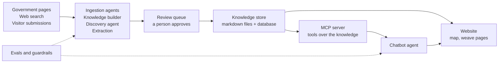

# Weaves: Tech design

**Version:** 0.1 (draft) · **Owner:** Oindrila · **Date:** 12 October 2026 · **Status:** For review

This says how Weaves will be built to meet the [BRD](BRD.md). It is plain-language on purpose. Choices marked **to check** have not been verified yet and are listed in [open-questions.md](open-questions.md).

## 1. The idea in one picture

Information flows left to right. Nothing reaches the knowledge store without a source, a trust tier and, when trust is low, a person's approval. Evals and guardrails watch the agents at both ends.

## 2. The agents

| Agent | Job | Model |
|---|---|---|
| **Knowledge builder** (a coordinator with helpers) | Takes a weave name, then a *search* helper finds pages, a *reader* helper reads them, an *extractor* turns them into a structured record, and a *verifier* checks the record against the [source tiers](../knowledge/policies/source-tiers-and-trust.md) | Haiku 4.5 for searching and reading, Sonnet 5.5 for extraction and verifying |
| **Discovery agent** | Finds candidate weavers in public web search results. It never opens Instagram or Facebook ([rules](../knowledge/policies/meta-platforms.md)). Candidates go to the review queue | Haiku 4.5, then Sonnet 5.5 for unclear cases |
| **Submission agent** | Reads a "Know a weaver?" link, note or screenshot and fills in a record for review | Sonnet 5.5 (needs to read images) |
| **Chatbot agent** | Answers questions by calling tools on the MCP server, citing sources ([scope](../knowledge/policies/chatbot-scope.md)) | Sonnet 5.5 |

**Structured output.** The extractor must return a record that fits a fixed JSON schema (weave, region, materials, technique, GI status, price range, source, tier, date). If it does not fit, the agent is told what is wrong and tries again, up to a set limit.

**The MCP server.** It offers the chatbot a few tools: `search_weaves`, `get_weave`, `check_gi_status`, `get_weaver_profile`. Tools return only approved records.

## 3. Guardrails (rules written as code)

- Every chatbot answer must cite at least one approved source, or say it does not know.
- Phone numbers and email patterns are blocked in answers.
- Out-of-scope questions get a polite redirect.
- Web pages and submissions are treated as untrusted text. Instructions inside them are ignored.
- Each visitor gets 20 messages a day. Spending alerts at $40 and a hard stop at $50 a month.
- Tools can never fetch Instagram or Facebook pages.

## 4. Evals

| Eval | Size | Checks |
|---|---|---|
| Chatbot questions with known good answers | about 100 | Correct, sourced, no claims beyond sources, right decline |
| Extraction records | about 50 | Fields correct |
| Verifier test records | about 50 | Bad records caught, good ones not flagged |
| Retrieval | same 100 questions | Right passage in the top 5 |
| Guardrail red-team prompts | about 30 | Zero leaks or rule breaks |

They run automatically on every change (GitHub Actions, **to check** the free allowance). Targets are in [success-targets.md](../knowledge/policies/success-targets.md).

## 5. Stack

| Part | Choice |
|---|---|
| Agents, pipeline, MCP server | Python with the Claude Agent SDK and API |
| Knowledge store | Markdown files in `knowledge/weaves/` plus a database with vector search (**to choose in M1**) |
| Search by meaning (RAG) | Embeddings model (**to choose in M3**; Anthropic does not make one, so we compare options and cost) |
| Website | Next.js (TypeScript), mostly pre-built pages, mobile-friendly |
| Map | MapLibre or Leaflet, with India's outer boundary from Survey of India material ([maps policy](../knowledge/policies/maps.md)) |
| Hosting | A free tier (**to check**) |
| Tests and checks | pytest, GitHub Actions |
| Building | Claude Code with `CLAUDE.md`, hooks and subagents; GitHub for saves |

## 6. Keeping to $50 a month

Split and prices are in [budget.md](../knowledge/policies/budget.md). The main savers: Haiku for cheap steps, the half-price batch option for bulk knowledge building, prompt caching, caching repeated chatbot answers, a monthly spend limit and a daily limit per visitor.

## 7. Build order

One milestone at a time, with a plain explanation of each step. Each teaches one exam domain.

| # | Milestone | Exam domain |
|---|---|---|
| M0 | Project set-up, `CLAUDE.md`, tests, hooks | 3 Claude Code |
| M1 | Knowledge schema with source, tier and trust. One weave written by hand. Choose the database | 4 Prompting and structured output |
| M2 | Extraction agent: page or screenshot to structured record | 4 |
| M3 | MCP server over the knowledge base. Choose embeddings | 2 Tools and MCP |
| M4 | RAG chatbot with guardrails | 1 Agentic architecture, 5 Context and reliability |
| M5 | Eval harness and automatic runs | 4, 5 |
| M6 | Knowledge builder, with helper agents | 1, 5 |
| M7 | "Know a weaver?" and the review queue | 1, 5 |
| M8 | Discovery agent | 1, 2 |
| M9 | Website: map, weave pages, chat, submit form | none (TypeScript) |
| M10 | Deploy, spend limit, monitoring | 5 |

A thin version of the website can come earlier if you want to see something on screen sooner. Community photo uploads (BR-17) come after this first cut.

## 8. Risks

- **Agents overspend.** Mitigation: limits above, test on small batches first.
- **Thin data at the start.** Mitigation: begin with officially recognised weaves and say honestly where information is missing.
- **Legal checks still pending.** See open question 1.
- **Too much at once for a beginner.** Mitigation: one milestone at a time, each ending in something that runs and is committed.
